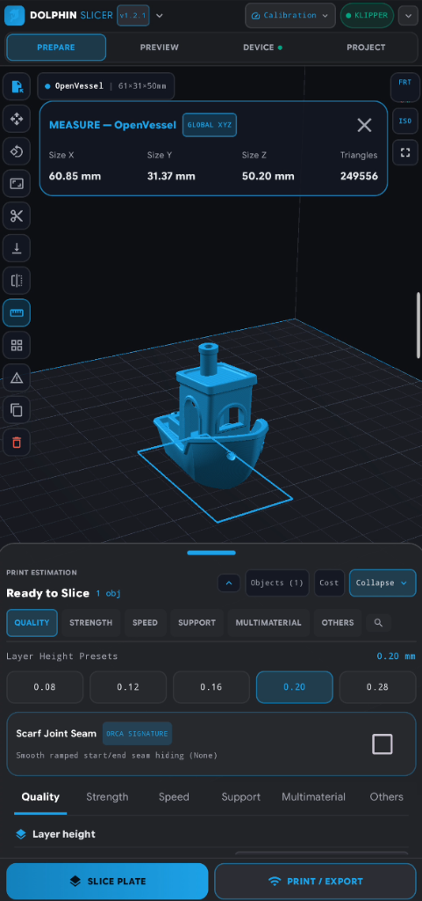
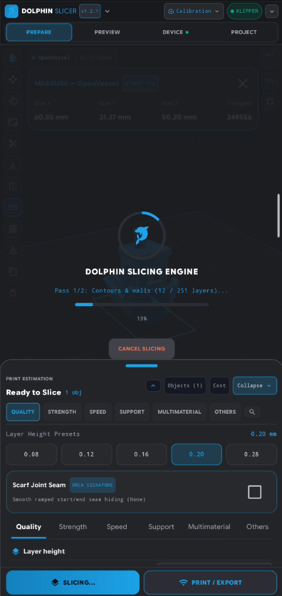
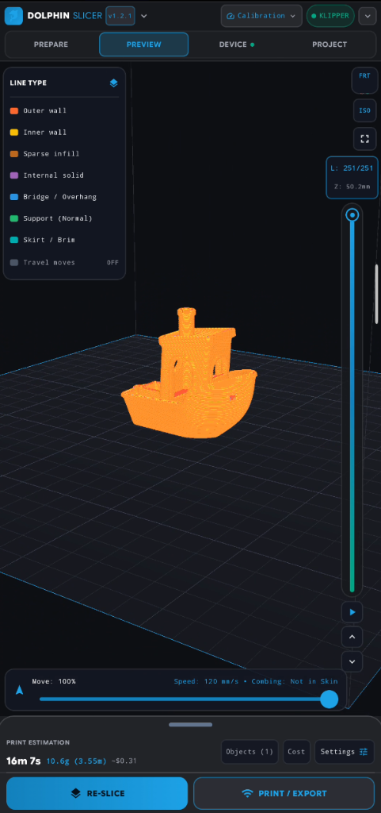
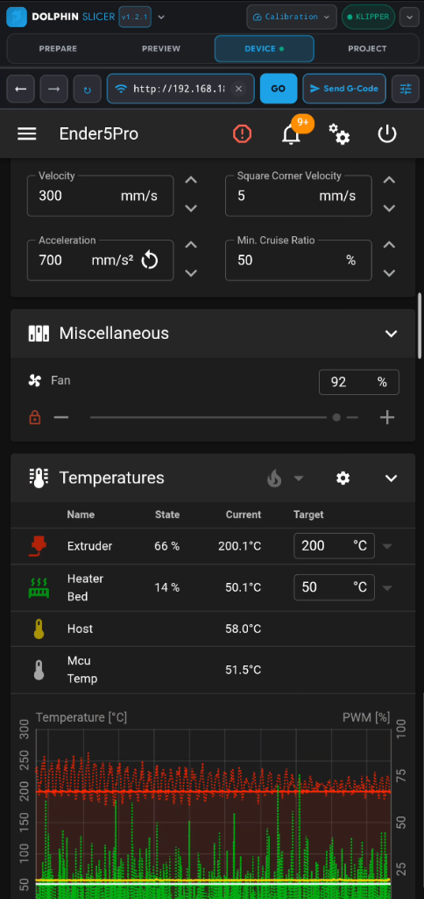

#  DolphinSlicer (OrcaSlicer for Android)

**DolphinSlicer** is a native Android 3D printing slicer inspired by [OrcaSlicer](https://github.com/OrcaSlicer/OrcaSlicer), featuring hardware-accelerated **OpenGL ES 3.0** 3D rendering, a **1:1 OrcaSlicer desktop UI layout** with adaptive **Portrait & Landscape** support, live official OrcaSlicer server profile synchronization, and a multi-threaded two-pass slicing engine.

## 📸 Screenshot Preview

<p align="center">
  
  
  
  
</p>

---

## ✨ Features

- **1:1 OrcaSlicer UI & Workflow**:
  - **Compact Top Navigation Bar (`#1F2022`)**: Unified Dolphin menu, `Prepare` | `Preview` | `Device` | `Project` tabs, and quick `Import`, `Slice`, and `Export` actions.
  - **Complete OrcaSlicer Process Settings**: Full 6-tab parameter suite (`Quality`, `Strength`, `Speed`, `Support`, `Multimaterial`, `Others`) including Precision, Seam, Scarf Joint, Ironing, Arachne/Classic Wall Generator, Overhang Speeds, Acceleration/Jerk, Prime Tower, Skirt/Brim, Special Modes, and G-code Post-Processing.
  - **Custom Currency System & Cost Calculator**: Preset global currencies (`$`, `€`, `£`, `¥`, `Rp`, `₹`, `₩`, `R$`, `₱`, `฿`, `₫`) plus a free-form custom currency symbol/code input box that updates across all filament profiles and production cost breakdowns.
  - **3D Viewport Overlays**: Interactive 3D Orientation **ViewCube** (`Top` / `Front` / `Left` with RGB `X`/`Y`/`Z` axes), sidebar collapse button (`‹›`), and 3D manipulation gizmos (`Move`, `Scale`, `Rotate`, `Lay Flat`, `Cut at Z`, `Mirror`, `Measure`, `Auto-Arrange`, `Clone`).
- **OpenGL ES 3.0 GPU Acceleration**:
  - Real-time 3D build plate rendering with overhang severity highlighting.
  - Volumetric 3D extruded bead ribbon preview (`GL_TRIANGLES`) with layer range and single-layer nozzle progress scrubbing.
- **Two-Pass Multi-Threaded Slicing Engine**:
  - Generates **Outer Wall**, **Inner Wall**, **Bottom Surface**, **Top Surface** (including intermediate horizontal roofs/steps and optional Ironing), **Internal Solid Infill**, **Sparse Infill** (`Gyroid`, `Grid`, `Honeycomb`, `Adaptive Cubic`, `Triangles`, `Tri-Hexagon`, `Rectilinear`, `Concentric`, `Cross Hatch`, `Lightning`), **Supports** (`Normal Grid` & `Tree Organic`), and **Skirt / Brim**.
- **Live Official OrcaSlicer Server Profile Sync**:
  - Synchronizes printer and filament profiles directly from the official `OrcaSlicer/OrcaSlicer` GitHub repository across 23 vendor catalogs (`Bambu Lab`, `Creality`, `Prusa`, `Voron`, `Qidi`, `Sovol`, `Elegoo`, `Anycubic`, `Flashforge`, `Flsun`, `RatRig`, etc.), in addition to 56+ built-in printer profiles and 51+ built-in filament profiles.
- **Filament & Production Cost Calculator**:
  - Computes model vs. support filament weight (`g`), length (`m`), volume (`cm³`), spool usage (`%` and prints/spool), electricity (`kWh`), machine wear, total production cost, and suggested quote price.
- **File Import & Export**:
  - Import: `.stl` (Binary & ASCII), `.obj`, `.3mf`, `.gcode`, and `.json` / `.ini` profiles.
  - Export: `.gcode` (Bambu / Klipper / Marlin / Prusa / RepRap), `.3mf` project archives, and Binary `.stl`.
- **Direct Wi-Fi Printer Control (`Device` Tab)**:
  - Upload and start prints directly over LAN to **Moonraker / Klipper** (Mainsail / Fluidd) and **OctoPrint** servers.

---

## 🛠️ Building from Source

```bash
./gradlew testDebugUnitTest assembleDebug
```

The debug APK is generated at `app/build/outputs/apk/debug/app-debug.apk`.

---

## 👥 Contributors

- **[@Nandaje](https://github.com/Nandaje)** — Creator & Lead Maintainer
- **Google Gemini 4 Antigravity** *(Google DeepMind)* — AI Engineering & Architecture Contributor

---

## ☕ Support & Donation

If you find **DolphinSlicer** useful for your 3D printing workflow, consider supporting ongoing development:

[](https://buymeacoffee.com/nandaje)

- **Buy Me a Coffee**: [https://buymeacoffee.com/nandaje](https://buymeacoffee.com/nandaje)


